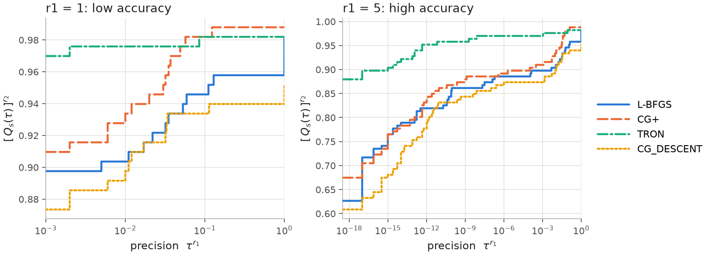
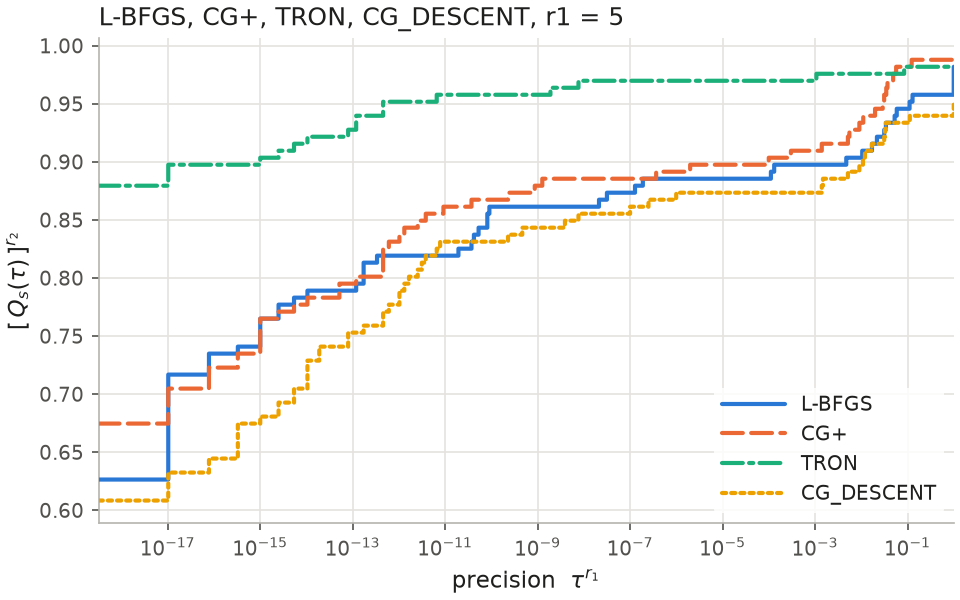
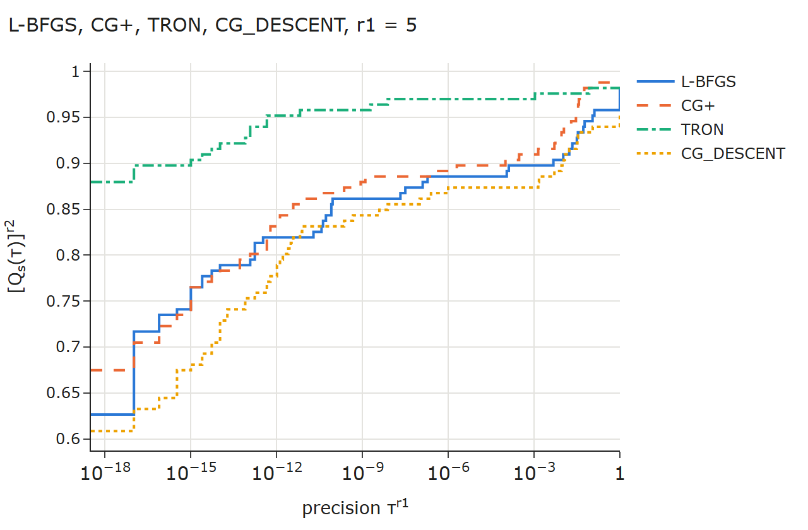
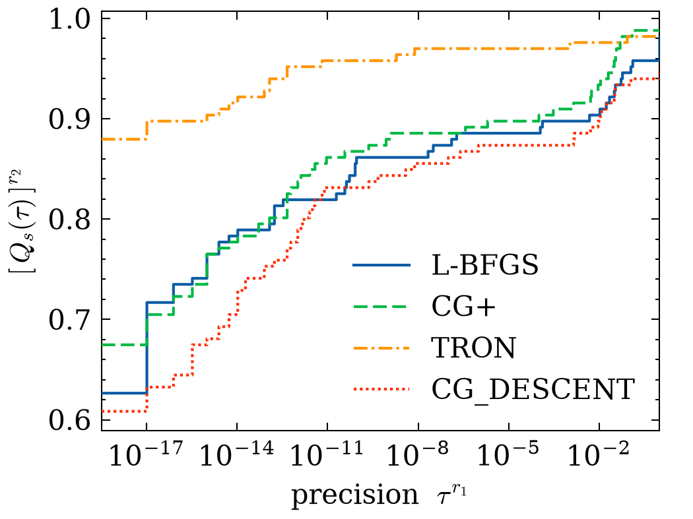
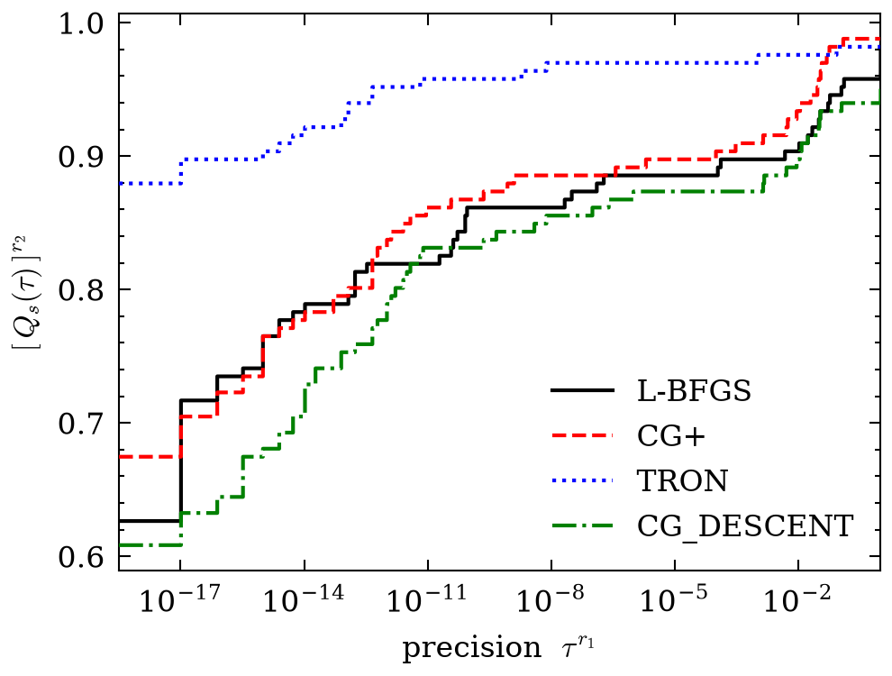
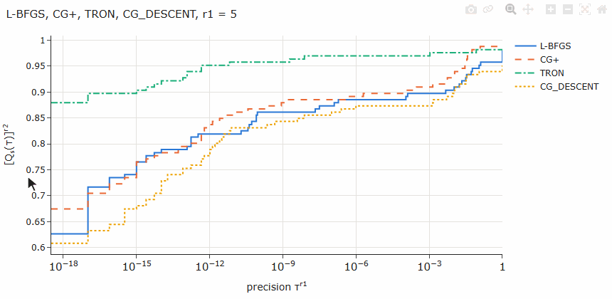
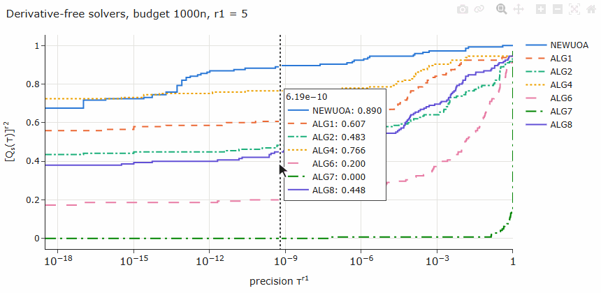

<h1 align="center">quality-profiles</h1>

<p align="center"><i>Benchmark optimization solvers by the quality of the solutions they return.</i></p>

<p align="center">
  <a href="docs/"></a>
  <a href="https://arxiv.org/abs/2607.16798"></a>
  <a href="LICENSE"></a>
  <a href="https://github.com/chripiermarini/QualityProfiles/stargazers"></a>
  <br>
  <a href="https://github.com/chripiermarini/QualityProfiles/actions/workflows/ci.yml"></a>
  <a href="https://github.com/chripiermarini/QualityProfiles/actions/workflows/lint.yml"></a>
  <a href="https://github.com/astral-sh/ruff"></a>
  <a href="pyproject.toml"></a>
  <a href=".github/workflows/ci.yml"></a>
  <br>
  <a href="https://pypi.org/project/quality-profiles/"></a>
  <a href="https://pypi.org/project/quality-profiles/"></a>
  <a href="https://anaconda.org/conda-forge/quality-profiles"></a>
  <a href="https://anaconda.org/conda-forge/quality-profiles"></a>
</p>

<p align="center">
  <a href="#installation"><b>Installation</b></a> ·
  <a href="#quick-start"><b>Quick start</b></a> ·
  <a href="#plot-styles"><b>Plot styles</b></a> ·
  <a href="#what-is-computed"><b>What is computed</b></a> ·
  <a href="#api"><b>API</b></a> ·
  <a href="#the-papers-experiments"><b>Paper's experiments</b></a> ·
  <a href="docs/"><b>Documentation</b></a> ·
  <a href="#citation"><b>Citation</b></a>
</p>

---

Performance and data profiles measure how much effort a solver needs. **Quality
profiles** measure something else: how good the final objective values are, relative to
a common starting point and a reference value, over the whole range of precision levels.
They need no a priori thresholds, and they handle failures and solvers that converge to
different local minimizers, so no test problem has to be excluded.

`quality-profiles` implements the method of

> G. Fasano, C. Piermarini, M. Roma.
> *Benchmarking Optimization Algorithms with Quality Profiles and Test Set Profiles.*
> Mathematical Programming Computation (accepted). [arXiv:2607.16798](https://arxiv.org/abs/2607.16798)

It is a Python port of the authors' reference MATLAB code
([fasano-g/Quality-Profiles](https://github.com/fasano-g/Quality-Profiles)). On the same
grid it gives exactly the same values, and it runs much faster: 20,000 problems and
20 solvers take a few hundredths of a second.

<p align="center">
  
  <br>
  <em>Four solvers on 166 CUTEst problems (Figures 4 and 5 of the paper). With <code>r1 = 5</code>
  the plot reaches 18 orders of magnitude and shows that TRON stays ahead at high accuracy.</em>
</p>

## Installation

From PyPI:

```bash
pip install quality-profiles                    # NumPy and Matplotlib only
pip install "quality-profiles[science]"         # + SciencePlots styles, for figures in papers
pip install "quality-profiles[interactive]"     # + Plotly, for interactive exploration
pip install "quality-profiles[all]"             # everything
```

The core package depends only on NumPy and Matplotlib. The extras are kept separate so
that a solver's test suite can use quality profiles without pulling in Plotly.

From source (development), with [uv](https://docs.astral.sh/uv/):

```bash
git clone https://github.com/chripiermarini/QualityProfiles
cd QualityProfiles
uv sync                    # .venv with the package, Plotly, SciencePlots and the dev tools
```

Requires Python 3.10 or later.

> The package is at version 0.1. The API may still change between minor versions.

## Quick start

For every test problem `p` you need the objective value at the common starting point,
`f0[p]`, and the best value found by each solver, `f_solvers[p, s]`. Use `NaN` to mark a
failure.

```python
import numpy as np
import matplotlib.pyplot as plt
from quality_profiles import quality_profiles, plot_quality_profiles

f0 = np.array([10.0, 3.0, 50.0, 7.0])           # f(x0) on 4 problems
f_solvers = np.array([                           # 3 solvers
    [1e-8,  2e-3,  0.5],
    [0.0,   1e-6,  1e-12],
    [12.0,  1e-4,  np.nan],                      # nan = failure
    [1e-3,  1e-3,  1e-9],
])

qp = quality_profiles(f0, f_solvers, solver_names=["A", "B", "C"], r1=4)

plot_quality_profiles(qp)      # semilog plot of [Q_s(tau^r1)]^r2
plt.show()

qp.evaluate([1e-1, 1e-3, 1e-6])  # fraction solved to 1, 3 and 6 orders of magnitude
qp.ranking()                     # solvers sorted by area under the profile
```

For a figure in a paper, or for interactive exploration:

```python
ax = plot_quality_profiles(qp, style=["science", "ieee"])  # needs the [science] extra
ax.figure.savefig("profiles.pdf")

from quality_profiles import plot_quality_profiles_interactive
fig = plot_quality_profiles_interactive(qp)                # needs the [interactive] extra
fig.show()                                                 # zoom, hover, hide solvers
fig.write_html("profiles.html")
```

The notebook [`notebooks/quality_profiles_example.ipynb`](notebooks/quality_profiles_example.ipynb)
walks through the paper's examples on the published results.

## Plot styles

The same profiles (Figure 5 of the paper) in the three ways the package can draw them.

<table>
<tr>
<td width="50%" align="center">
  <br>
  <b>Default</b><br><code>plot_quality_profiles(qp)</code>
</td>
<td width="50%" align="center">
  <br>
  <b>Interactive (Plotly)</b><br><code>plot_quality_profiles_interactive(qp)</code>
</td>
</tr>
<tr>
<td width="50%" align="center">
  <br>
  <b>SciencePlots</b>, one journal column<br><code>plot_quality_profiles(qp, style="science")</code>
</td>
<td width="50%" align="center">
  <br>
  <b>SciencePlots + IEEE</b>, works in black and white<br><code>style=["science", "ieee"]</code>
</td>
</tr>
</table>

The matplotlib figures can be saved as PDF, SVG or PNG; for a paper, prefer PDF. The
Plotly figure is saved as an interactive HTML page with `fig.write_html(...)`.

### Interactive figures

Hovering shows the value of every solver at the precision level under the cursor:

<p align="center">
  
</p>

With many solvers, click a name in the legend to hide it, and drag a box to zoom; a
double-click goes back to the full view. Here, on the seven derivative-free solvers of
Figure 12:

<p align="center">
  
</p>

The gallery is drawn by [`examples/make_readme_gallery.py`](examples/make_readme_gallery.py).

## What is computed

For every solver $s$ and precision level $\tau \in [0, 1]$, the quality profile
$Q_s(\tau)$ is the fraction of test problems on which $s$ reduced the gap between the
starting value $f(x_0)$ and a reference value $f_L$ (by default the best value found by
any solver) by at least a factor $\tau$. The package computes the scaled profiles
$[Q_s(\tau^{r_1})]^{r_2}$: `r1` zooms the abscissa, `r2` the ordinate, and neither changes
the ranking of the solvers.

On a semilog plot, the value at precision $10^{-k}$ is the fraction of problems on which
a solver gained at least $k$ orders of magnitude; the higher the curve, the better.

The definitions, weak and strong profiles, the choice of reference value, the scaling,
the properties proved in the paper and the handling of failures are described in
[**docs/what-is-computed.md**](docs/what-is-computed.md).

## API

| Function / class | Description |
| --- | --- |
| `quality_profiles(f0, f_solvers, ...)` | Compute the profiles; returns a `QualityProfile`. |
| `QualityProfile` | Sampled profiles, with `evaluate(levels)`, `area()` and `ranking()`. |
| `plot_quality_profiles(profile, ...)` | Matplotlib step plot, optionally with a matplotlib or SciencePlots `style`. |
| `plot_quality_profiles_interactive(profile, ...)` | Interactive Plotly figure (`[interactive]` extra). |
| `split_matrix(tt)` | Split a MATLAB-style `P x (1+S)` results matrix into `f0` and `f_solvers`. |

Every parameter, return value and error is documented in [**docs/api.md**](docs/api.md).

## The paper's experiments

[`examples/data`](examples/data) contains the results published with the paper, one CSV
file per experiment: the starting value `f0`, then one column per solver.

<details>
<summary><b>Datasets</b></summary>

<div align="center">

| File | Problems | Solvers | Paper figures |
| --- | --- | --- | --- |
| `two_solvers.csv` | 166 | Solver-1, Solver-2 | 2, 3 |
| `cutest_smooth.csv` | 166 | L-BFGS, CG+, TRON, CG_DESCENT | 4–8 |
| `negative_curvature.csv` | 166 | TN-NONegCurv, TN-NC1, TN-NC2, TN-NC3 | 9–11 |
| `dfo_budget_1000n.csv` | 145 | NEWUOA and six Direct Search methods | 12 |
| `dfo_budget_750n.csv` | 145 | same | 13 |
| `dfo_budget_500n.csv` | 145 | same | 14 |
| `dfo_budget_250n.csv` | 145 | same | 15 |

</div>

Where the data come from, and one correction made to the MATLAB files, is described in
[`examples/data/README.md`](examples/data/README.md).

</details>

```bash
uv run python examples/reproduce_paper_figures.py    # redraw the paper's figures
uv run python examples/compare_plot_styles.py        # one figure in every plot style
uv run python examples/try_plot_styles.py --help     # SciencePlots and Plotly on every dataset
```

## Development

```bash
uv sync                          # environment with Plotly, SciencePlots and the dev tools
uv run pytest                    # unit tests and doctests
uv run pytest --nbmake notebooks # execute the example notebook
uv run ruff check . && uv run ruff format --check .
uv run mypy                      # strict type checking
uv build                         # build the sdist and the wheel into dist/
```

The tests check every result against a line-by-line port of the MATLAB algorithm, and
check the properties proved in the paper.

## Citation

If you use this package, please cite the paper (see [`CITATION.cff`](CITATION.cff)):

```bibtex
@article{FasanoPiermariniRoma2026QualityProfiles,
  title   = {Benchmarking Optimization Algorithms with Quality Profiles and Test Set Profiles},
  author  = {Fasano, Giovanni and Piermarini, Christian and Roma, Massimo},
  journal = {Mathematical Programming Computation},
  note    = {Accepted. arXiv:2607.16798},
  year    = {2026}
}
```

## Questions

Open an [issue](https://github.com/chripiermarini/QualityProfiles/issues).

## License

MIT. See [LICENSE](LICENSE).
